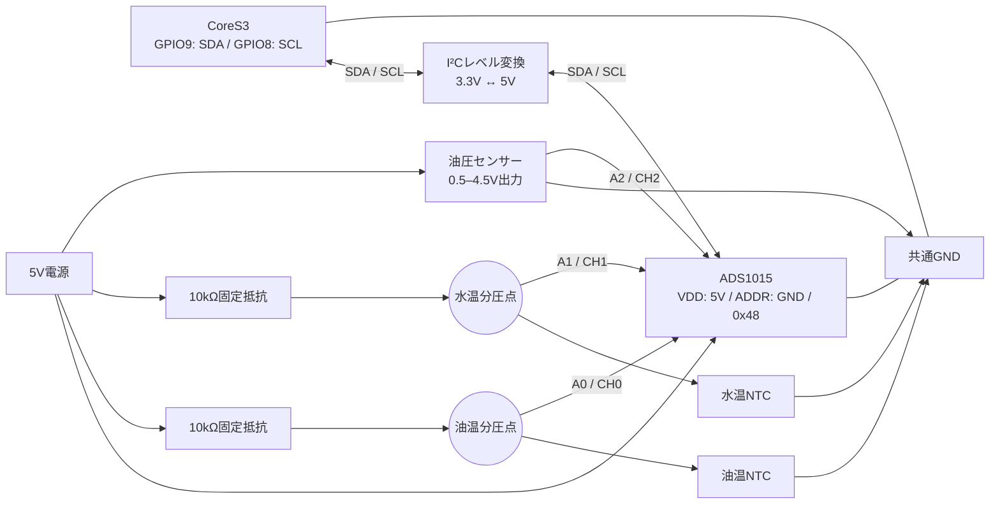

# M5Stack CoreS3 Racing Gauge

[](https://github.com/puriso/racing_gauge/actions/workflows/pio-build.yml)

**油圧・水温・油温を、ひとつの画面で。** M5Stack CoreS3とADS1015を使用した、車載用デジタルメーターです。
アナログ風ゲージ、低油圧警告、最高値の確認を備え、走行中の状態把握を補助します。

A digital oil-pressure and temperature dashboard for M5Stack CoreS3 + ADS1015. [English quick start](#english-quick-start)

[等速の動作確認ページを開く](https://puriso.github.io/racing_gauge/)

油圧3〜6barの連続変動、2.0Gでの油圧急落、Rモードの保持・解除、温度の上昇・下降を、
PRごとの等速動画で確認できます。[シミュレーターと録画の使い方](simulator/README.md)。
生ADCカウント・IMU各軸・照度を本番のセンサー処理へ渡し、変換・補正・取得周期・平均化から表示まで確認します。
シミュレーションと動画は24FPS・1.0倍速です。
確認ページは24シナリオを収録し、生ADCの毎フレーム1カウント往復、信号断線、200℃以上、PDF00903Sの動作下限-20℃前後と正常復帰も確認できます。

ADC通信異常への対応（[#381](https://github.com/puriso/racing_gauge/pull/381)）はmainへ取り込み済みです。
[通信異常の動画](https://puriso.github.io/racing_gauge/previews/pr-381/18b5be26fc6a439f017c427d5edc0458e796d3e2/#adc-communication)と[起動時未接続の動画](https://puriso.github.io/racing_gauge/previews/pr-381/18b5be26fc6a439f017c427d5edc0458e796d3e2/#adc-startup)で、5msの変換期限・1秒間隔の再接続・正常復帰を確認できます。

現在レビュー中の変更には、専用の確認ページがあります。mainへ取り込まれた機能とは区別してください。

| PR | 追加内容と確認ページ |
| --- | --- |
| [#380](https://github.com/puriso/racing_gauge/pull/380) | LOWの再発・保持を修正し、発生履歴Wを左下に保持。詳細画面から戻るとWを消去。[W履歴の動画](https://puriso.github.io/racing_gauge/previews/pr-380/5139c7b3f342fad1ef6a116c73d7f90c1f6d7ccf/#warning-history) |

[Real-time visual review](https://puriso.github.io/racing_gauge/): continuous pressure changes, circuit pressure drops,
racing-mode transitions, and heating/cooling scenarios. All videos play at normal speed.


[機能](#機能) · [セットアップ](#セットアップ) · [配線](#ハードウェアと配線) · [設定](#設定) · [開発・検証](#開発と検証)

## 機能

| 表示 | 内容 | 初期設定の目盛・しきい値 |
| --- | --- | --- |
| 油圧 | アナログ風ゲージと数値 | 0–10 bar、8 bar以上で赤色 |
| 水温 | アナログ風ゲージと数値 | 85–115°C、110°C以上で赤色 |
| 油温 | 画面上部のバーと数値 | 80–130°C、120°C以上で赤色 |
| 詳細画面 | 最高油圧・最高水温・最高油温、直近の低油圧イベント、照度 | 画面タップで開閉 |

- **低油圧警告**：水平Gが1.0 Gを超え、表示用の油圧が3.0 bar以下の状態が500ms継続すると、`LOW`を表示します。警告条件の最終検知から3秒間の表示保持を設けています。
- **レーシングモード**：水平Gが1.0 G以上の状態が100ms継続すると、3分間、輝度を最大にして`R`を表示します。
- **ADC通信異常への対応**：変換完了待ちは5msで打ち切り、通信失敗後は1秒間隔で再接続します。正常取得に戻るまで温度・油圧を異常時の値として扱います。
- **自動調光**：周囲光に応じて3段階の輝度に切り替えます。初期設定では有効です。
- **デモモード**：外付けADC・センサーを接続せずに表示を確認できます。初期設定では無効です。

油圧の画面上の単位`x100kPa`はbarと同じ大きさです（1 bar = 100 kPa）。
最高値・イベント履歴はメモリ上に保持し、再起動するとリセットされます。最高値は正常な取得・平均値から更新し、通信・信号異常では消去しません。初回正常値が負温度でもその値から記録し、正常値を一度も取得していない最高値は`---`で表示します。詳細画面中もLOW判定・最高値更新を継続し、Rへの移行は停止します。

## セットアップ

### 1. 開発環境を用意する

[PlatformIO Core](https://docs.platformio.org/en/latest/core/installation/index.html)をインストールします。
VS CodeのPlatformIO IDEを利用する場合は、内蔵のPlatformIOターミナルで以下を実行できます。

```sh
git clone https://github.com/puriso/racing_gauge.git
cd racing_gauge
pio run -e m5stack-cores3
```

生成されるファームウェアは`.pio/build/m5stack-cores3/firmware.bin`です。
ボード定義とライブラリの指定は[platformio.ini](platformio.ini)で管理しています。
Espressif32 8.0.0、M5GFX 0.3.0、M5Unified 0.2.29、M5CoreS3 1.0.1、ADS1X15 2.6.2、BusIO 1.17.4に固定し、描画ライブラリのM5GFXはSDLと同じ版を使います。

### 2. USB接続して書き込む

```sh
pio device list
```

一覧からCoreS3のポートを確認し、書き込み時に指定します。以下はmacOSの例です。
`/dev/cu.usbmodemXXXX`を実際のポート名に置き換えてください。

```sh
pio run -e m5stack-cores3 -t upload --upload-port /dev/cu.usbmodemXXXX
pio device monitor --port /dev/cu.usbmodemXXXX --baud 115200
```

Windowsでは`COM11`、Linuxでは`/dev/ttyACM0`など、環境に合ったポート名を使用します。
現在の`platformio.ini`には`upload_port = COM11`が設定されているため、異なる環境では上記の`--upload-port`で上書きしてください。
コマンドの詳細は[PlatformIOの公式リファレンス](https://docs.platformio.org/en/stable/core/userguide/cmd_run.html)を参照してください。

### 3. 表示とセンサー値を確認する

起動直後はIMUの安定化待ちとオフセット推定を行うため、本体を静止させてください。
センサーを接続する前に画面を確認したい場合は、[include/config.h](include/config.h)の`DEMO_MODE_ENABLED`を`1`に変更し、再ビルド・書き込みします。
実測に戻す際は`0`に戻してください。

## ハードウェアと配線

### 構成とチャンネル

| 機器・信号 | 使用対象・方式 | コード上の接続先 |
| --- | --- | --- |
| 本体 | M5Stack CoreS3 / ESP32-S3 | 320 × 240画素の内蔵ディスプレイ |
| ADC | ADS1015 / 12bit・4チャンネル | I²Cアドレス`0x48` |
| 油温 | Defi PDF00903S / NTC抵抗式 | ADS1015 A0 / CH0 |
| 水温 | Defi PDF00903S / NTC抵抗式 | ADS1015 A1 / CH1 |
| 油圧 | Defi PDF00703S / 電圧出力式 | ADS1015 A2 / CH2 |
| 外部I²C SDA | CoreS3 GPIO9 | ADS1015 SDAとのレベル整合が必要 |
| 外部I²C SCL | CoreS3 GPIO8 | ADS1015 SCLとのレベル整合が必要 |

上記は[config.h](include/config.h)と[setup()](src/main.cpp)の割り当てです。
本体のコネクター・ピン配置は[M5Stack公式資料](https://docs.m5stack.com/en/core/CoreS3)と照合してください。

### 接続の考え方

温度入力は、5V側の10kΩ固定抵抗とGND側のNTCによる分圧を想定しています。
油圧入力は0.5–4.5Vの電圧を換算します。温度センサーを同じ電圧出力式として接続しないでください。



これは接続関係のブロック図です。レベル変換回路の電源・プルアップ抵抗は、使用する基板の回路図に従って接続してください。
レベル変換を内蔵するADC基板では、その基板の入出力仕様を確認します。

ESP32-S3の3.3V系GPIOと、5V駆動のADS1015のI²C信号にはレベル整合が必要です。
ADS1015のゲイン設定`±6.144V`も、電源電圧を超えるアナログ入力を許可するものではありません。
電気的条件は[ESP32-S3データシート](https://documentation.espressif.com/esp32_s3_datasheet_en.pdf)と[ADS1015データシート](https://www.ti.com/lit/ds/symlink/ads1015.pdf)を参照してください。

### 電源設定

想定する実機の給電経路は、`車載12V → DinBaseのDC入力 → 内蔵降圧回路 → 5V → CoreS3・ADS1015`です。
DinBaseはDC 9–24V入力と内蔵の降圧回路を備えています。[DinBase公式資料](https://docs.m5stack.com/en/base/Base_DIN)
CoreS3〜ADS1015のI²C配線は、実機では3cm未満です。

**DC入力給電では、CoreS3から外部へ5Vを出す設定と給電方向を合わせる必要があります。**
[公式の電源サンプル](https://github.com/m5stack/M5CoreS3/blob/main/examples/Basic/power/power.ino)は、DC入力・Groveからの給電時に`cfg.output_power = false`を指定しています。
現行mainの`setup()`は、次のように外部5V出力を有効化しています。

```cpp
M5.Power.setExtOutput(true);
```

DinBaseのDC給電と合わせた出力設定の変更は、現行mainには未適用です。
`EXTERNAL_5V_OUTPUT_ENABLED`という切替設定も現在の`config.h`にはありません。
初期化と後段の外部出力指定を給電方向に合わせて確認してください。
旧[#382](https://github.com/puriso/racing_gauge/pull/382)は未マージで終了しており、適用済みの設定例としては扱いません。

5Vピンへ直接外部給電する場合も、外部出力を有効にした状態で別電源を同時接続しないでください。

コードの`setBatteryCharge(false)`はPMU側への充電停止設定です。
DinBaseは別の充電ICも搭載するため、底座を含むすべての充電回路がこの指定で停止するとは扱いません。

## 設定

主な設定は[include/config.h](include/config.h)を編集して変更します。変更後は再ビルド・書き込みが必要です。

| 設定 | 初期値 | 内容 |
| --- | --- | --- |
| `DEMO_MODE_ENABLED` | `0` | デモ表示 |
| `SENSOR_OIL_PRESSURE_PRESENT` | `1` | 油圧センサーの使用 |
| `SENSOR_WATER_TEMP_PRESENT` | `1` | 水温センサーの使用 |
| `SENSOR_OIL_TEMP_PRESENT` | `1` | 油温センサーの使用 |
| `SENSOR_AMBIENT_LIGHT_PRESENT` | `1` | 周囲光センサーによる自動調光 |
| `DEBUG_MODE_ENABLED` | `0` | シリアルへのセンサー値・FPS出力 |
| `FPS_DISPLAY_ENABLED` | `0` | 画面上のFPS表示 |
| `VOLTAGE_DROP` | `0.137V` | 油圧・温度の換算に使う電圧降下補正 |
| `PRESSURE_SAMPLE_SIZE` | `5` | 油圧の平均サンプル数 |
| `WATER_TEMP_SAMPLE_SIZE` / `OIL_TEMP_SAMPLE_SIZE` | `2` | 温度の平均サンプル数 |

油圧は各フレームで取得し、直近5サンプルの平均に平滑化を適用します。
水温・油温はそれぞれ500msごとに取得し、直近2サンプル、約1秒分を平均してから表示を平滑化します。
温度平均は新しいサンプルが入る500msごとに更新されます。
通信失敗・温度異常時は温度バッファを200℃で初期化し、復帰時は最初の正常値から平均化を再開します。通信失敗時の油圧バッファは0へ初期化します。通信異常を検出した時点で全有効チャンネルを無効化し、表示は`ERR`に切り替えます。異常値を表示用平滑化へ混ぜず、正常取得後に再開します。

LCDは上段・油圧・水温・履歴表示を個別に部分転送し、同じ数値文字列や油温の固定目盛りは再描画を省きます。油圧領域だけの更新は160×180画素（RGB565で57,600バイト）で、全面320×240画素の153,600バイトから62.5%削減します。これは転送量の比較で、実機FPSの計測値ではありません。

低油圧警告・バーの赤色しきい値は[src/modules/low_warning.cpp](src/modules/low_warning.cpp)と[src/modules/display.cpp](src/modules/display.cpp)、
温度の取得間隔・換算係数は[src/modules/sensor.cpp](src/modules/sensor.cpp)で定義しています。

## センサーの換算と校正

### 油圧

補正後の電圧`V`に対して、`P [bar] = 2.5 × (V − 0.5)`で換算します。0.5V以下は0 barとして扱います。

| 補正後の電圧 | 換算油圧 |
| --- | --- |
| 0.50V | 0 bar |
| 1.30V | 2 bar |
| 2.50V | 5 bar |
| 4.50V | 10 bar |

ADC入力0V、4.9V以上の過電圧、換算油圧11bar以上、ADC通信異常は`ERR`で表示します。未取得・センサー無効は`---`、正常な0barは`0.0`です。異常中はLOWの新規判定と最高値更新を止め、成立済みのLOW保持とW履歴は残します。

### 水温・油温

使用する温度センサーは **Defi PDF00903S** です。圧力センサーは **PDF00703S** です。
[メーカーのセンサー仕様](https://defi.nippon-seiki.co.jp/installation/sensor/)と[取扱説明書](https://defi.nippon-seiki.co.jp/wp-content/uploads/2025/03/manual_din.pdf)に基づき、温度センサーの**動作範囲は-20〜150℃**です。
保存温度範囲（-30〜150℃）やメーターの表示範囲とは区別します。動作範囲外というだけで故障を断定するものではありません。

10kΩの基準抵抗、`R25 = 10kΩ`、`B = 3380K`のβ式を使用します。
以下は実装の換算モデルから求めた参考値であり、センサー製造元の保証値や実測の校正データではありません。

<details>
<summary>温度とNTC抵抗値の参考表</summary>

| 温度 | 抵抗値 |
| --- | --- |
| 0°C | 28,221.67Ω |
| 10°C | 18,230.65Ω |
| 20°C | 12,133.01Ω |
| 30°C | 8,294.71Ω |
| 40°C | 5,810.08Ω |
| 50°C | 4,160.37Ω |
| 60°C | 3,039.42Ω |
| 70°C | 2,261.49Ω |
| 80°C | 1,711.08Ω |
| 90°C | 1,314.67Ω |
| 100°C | 1,024.46Ω |
| 110°C | 808.78Ω |
| 120°C | 646.23Ω |

</details>

入力電圧が換算可能な範囲を外れる場合は、内部で200°Cを異常値として使用します。
表示側には199°C以上を0扱いにする処理があります。動作範囲外という入力の分類と、製品側の異常判定は別です。
通信失敗時は温度平均のバッファを異常値で初期化し、復帰時に正常値から再開します。異常値を正常な温度平均へ混ぜたままにしません。

センサーの型番だけで測定精度が決まるわけではありません。
使用するセンサーの特性、基準抵抗、実際の電源電圧・配線の電圧降下に合わせて、換算係数と`VOLTAGE_DROP`を確認してください。
起動時の静止姿勢も水平Gの基準に影響します。

## 開発と検証

### ソース構成

| パス | 役割 |
| --- | --- |
| [src/main.cpp](src/main.cpp) | 初期化・フレーム制御・タッチ操作 |
| [src/modules/adc_reader.cpp](src/modules/adc_reader.cpp) | ADC通信・5ms変換期限・1秒間隔の再接続 |
| [src/modules/sensor.cpp](src/modules/sensor.cpp) | ADC・IMU取得、換算、サンプル管理 |
| [src/modules/display.cpp](src/modules/display.cpp) | ゲージ・詳細画面・最高値 |
| [src/modules/low_warning.cpp](src/modules/low_warning.cpp) | 低油圧警告・イベント情報 |
| [src/modules/racing_mode.cpp](src/modules/racing_mode.cpp) | レーシングモードの判定 |
| [src/modules/backlight.cpp](src/modules/backlight.cpp) | 周囲光による輝度制御 |
| [include/config.h](include/config.h) | 機能フラグ・表示・サンプル数などの設定 |

### CIと関連する改善

[GitHub Actions](.github/workflows/pio-build.yml)では、CoreS3向けファームウェアをビルドし、`firmware`アーティファクトとして保存します。
Markdownだけの変更は、現在のワークフローでは実行対象外です。

mainのCIではADC通信異常・再接続の本番C++テスト11件も実行します。ローカルでの手順は[test/adc_reader/README.md](test/adc_reader/README.md)を参照してください。
現在レビュー中なのは低油圧警告の改善です。内容と動画は冒頭のPR一覧から確認できます。

| PR | 検証する内容 |
| --- | --- |
| [#380](https://github.com/puriso/racing_gauge/pull/380) | 再発・500ms判定・3秒保持・32ビット時刻折り返し、W履歴と詳細画面からの復帰時リセット |

旧#378・#382は未マージで終了しています。#379は#378のブランチへ取り込まれた変更で、mainへの適用済み機能とは扱いません。
各PRに固有のテストコマンドは、そのPRの本文とブランチ上のガイドを参照してください。

描画は最大60FPSとなるよう制御していますが、実際のフレームレートはADC取得・描画・画面転送の時間に依存します。
ビルドやホストテストの成功は、実機でのセンサー精度・電源変動・ノイズ耐性の確認とは別です。

### SDLシミュレーターとCI録画

実機なしで本番の描画を動かし、温度・油圧の変化と警告表示を確認できます。
CIではMP4・PNG・HTMLのレポートを保存します。確認ページの公開成功ごとに新しいPRコメントを追加します。
シミュレーターの24FPSは設定値であり、実機FPSの計測結果ではありません。実機FPSの推定・比較機能は含みません。
動画の製品画面外に生ADC・電圧・IMU・G・照度・期待値を表示し、HTMLの確認時刻ボタンから各場面へ移動できます。
セットアップと録画の見方は[シミュレーターのガイド](simulator/README.md)を参照してください。

## English quick start

This project displays oil pressure, water temperature, and oil temperature on an M5Stack CoreS3 using an external ADS1015.
Tap the screen to view recorded peaks and the latest low-pressure event. Records are held in RAM and reset on reboot.

### Build and upload

Install [PlatformIO Core](https://docs.platformio.org/en/latest/core/installation/index.html), then run:

```sh
git clone https://github.com/puriso/racing_gauge.git
cd racing_gauge
pio run -e m5stack-cores3
pio device list
```

Replace the macOS example port below with the port reported for your device:

```sh
pio run -e m5stack-cores3 -t upload --upload-port /dev/cu.usbmodemXXXX
pio device monitor --port /dev/cu.usbmodemXXXX --baud 115200
```

The project currently sets `upload_port = COM11`; the command-line option overrides it.
Library versions in [platformio.ini](platformio.ini) use compatible ranges rather than exact pins.

### Hardware and operation

- **ADC inputs:** A0/CH0 oil temperature, A1/CH1 water temperature, A2/CH2 oil pressure; default address `0x48`.
- **I²C pins:** GPIO9 SDA and GPIO8 SCL. Match the 3.3V GPIO and 5V ADC logic levels; see the [wiring section](#ハードウェアと配線) and the linked device datasheets.
- **Temperature inputs:** NTC dividers with a 10kΩ resistor on the supply side and the NTC on the GND side. They are not 0.5–4.5V voltage-output sensors.
- **Power:** The intended setup uses the DinBase DC input at 12V and its built-in buck converter. Current main enables external 5V output with `M5.Power.setExtOutput(true)` and has no `EXTERNAL_5V_OUTPUT_ENABLED` switch. Align initialization and output settings with the power direction; see the [power section](#電源設定). The former #382 was closed without merging. Do not feed the 5V pin from another source while its output is enabled.
- **Sampling:** Pressure uses five samples plus smoothing. Each temperature is sampled every 500ms and averaged over the latest two samples, then smoothed; the average changes every 500ms.
- **Defaults:** Ambient-light dimming is enabled; demo mode, debug logging, and the FPS overlay are disabled. Edit [config.h](include/config.h) and rebuild to change them.
- **Calibration:** Keep the device still during startup IMU calibration. Match the NTC model and voltage-drop correction to your sensor and wiring. Sensor faults display `ERR`; unmeasured readings and maxima display `---`.

The sensor table above describes the firmware's conversion model, not manufacturer calibration data.
Main includes twenty-four 24 FPS real-time preview scenarios, including raw ADC sweeps, disconnected signals, temperature boundaries, negative-temperature maxima, and ADC communication failures.
ADC waits are bounded to 5ms and reconnection is attempted at one-second intervals; temperature recovery starts from the first valid sample.
Main includes a latched W cleared when leaving the detail screen. Maxima start from the first valid sample, including negative temperatures; unmeasured maxima display `---`. Successful preview publication creates a new PR comment. Simulation FPS is a setting, not a measurement of the device.
Hardware accuracy and vehicle behavior require separate verification.

## ライセンス / License

Copyright © 2025 purin. **All rights reserved.**

利用・再配布の条件は[LICENSE](LICENSE)を参照してください。MITライセンスではありません。
Use and redistribution require the author's explicit written permission under [LICENSE](LICENSE).
