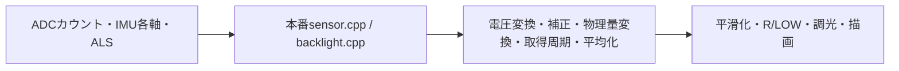

# SDLシミュレーターと等速での動作確認

[確認ページをブラウザーで開く](https://puriso.github.io/racing_gauge/)

本番のセンサー取得・変換・平均化・描画・平滑化・Rモード・LOW警告をSDLで実行し、**24FPS・等速のMP4とindex.html**にまとめます。
PRのコメントから、ZIPを展開せずGitHub Pages上の確認ページを直接開けます。
更新・録画は24FPS、すべて1.0倍速です。Rモードの3分保持も実時間どおりに保存し、確認時刻ボタンから場面へ移動できます。

動画・GIFには、320×240の製品画面の**外側**に入力と期待値を表示します。MP4を直接開いても数値を追えます。

| 外側の表示 | 意味 |
| --- | --- |
| RAW SENSOR / VOLTAGE | ADCの生カウントと電圧、IMUのX/Y/Z（g）、照度の取得値 |
| EXPECTED AVG / FILTER | ADC変換・取得周期・移動平均を経た期待値と、さらに表示用平滑化を通した期待値 |
| EXPECT / ACTUAL | R・LOW・昼/夕方/夜・輝度0〜255・取得照度・6点中央値・油圧過電圧の期待値と実際の状態 |

期待する平滑化値は小数2桁で表示します。実画面には整数化・小数1桁化に加え、
油温0.1℃／水温0.05℃／油圧0.05bar未満の変化を描き直さない処理があるため、数字が完全一致しない場面があります。
輝度は実際の設定値を比較します。SDLの画素を暗くする加工は行いません。

## 生の取得値から計算する経路

温度・油圧や計算済みの水平Gを、センサー配列や判定変数へ直接注入しません。
`sensor.cpp`をそのままリンクし、`acquireSensorData()`を毎フレーム実行します。



- ADCは`readADC_SingleEnded()`の戻り値を置き換えます。12bitカウント→電圧→電圧降下補正→温度・油圧の変換を省略しません。
- 配線はCH0=油温、CH1=水温、CH2=油圧。油圧は5点移動平均、温度は500msごとに取得して2点平均します。
- IMUは`getAccelData()`が返すX/Y/Z（g）を置き換えます。200msの安定待ち・20サンプルのオフセット補正・水平G・方向判定・縦軸除外を本番処理で行います。
- ALSは`getAlsValue()`の戻り値を置き換え、8秒周期の測定・6点中央値・輝度判定を本番処理で行います。

シナリオの℃・bar・Gは生の入力波形を作るための目標です。温度・油圧の逆変換はADC刺激の生成にだけ使い、
表示・判定は必ずADCカウントから再計算します。量子化のため目標値と計算結果には差があります。
たとえば油圧3bar相当のADC=551は約3.000996barとなり、3bar境界も生値から判定します。

起動中にIMU補正が終わるまでは、本番コードが温度・油圧の取得も返さず終了します。
24FPSで仮想時刻0から起動した場合は約1.04秒まで取得値が0となり、その後も500ms取得・移動平均・平滑化による遅れがあります。
初期バッファを目標値で埋める処理は行いません。

## シナリオ

通常走行の油圧は、4秒周期で**3.0〜6.0barを連続往復するADC入力**を作ります。
始動直後、意図的な急落、専用の全レンジ試験を除き、5.0barで固定する場面はありません。

| シナリオ | 長さ | 確認する内容 |
| --- | --- | --- |
| `circuit` | 36秒 | 最大2.0Gの瞬間入力と油圧0.8barへの急落。短時間の非点灯、継続時のR・LOW、回復・保持・消灯 |
| `racing` | 196秒 | 50msの2.0GではRに入らず、1.0G継続で進入。G解除後も3分保持し、時限解除・再進入・詳細画面での解除を確認 |
| `ambient` | 136秒 | 100→12→2→100lux、昼→夕方→夜→昼。8秒ごとの測定・6点の上側中央値・夜間の詳細画面での最大輝度と復帰 |
| `raw-faults` | 24秒 | 油温ADC=0、水温ADC=2047、油圧ADC=1633（過電圧）、全ADC=0、復帰。温度異常・平均化・油圧の異常判定を確認 |
| `ramp` | 200秒 | 油温-10→170→-10℃、水温-10→130→-10℃。上昇後、同じ動画内で保持から下降へ進む |
| `cooldown` | 100秒 | 高温から低温へ下降。バーの消去、赤表示の解除、低温端を確認 |
| `pressure-sweep` | 20秒 | 油圧0→10→0barの専用全レンジ試験。上昇・下降、8bar以上の赤表示を確認 |
| `warnings` | 40秒 | 通常変動中に3.1/3.0/2.9barへ250ms低下。2.9barの2秒保持でLOW点灯・保持・解除 |
| `startup` | 30秒 | 最初の2秒は70℃相当ADCを保持し、IMU補正後の取得を確認。その後-10℃相当へ戻って暖機 |
| `warm-start` | 30秒 | 70℃から暖機。始動後は油圧3〜6barで連続変動 |
| `menu` | 20秒 | 8〜13秒は詳細画面。油圧の変動、通常表示への復帰や残像を確認 |

`circuit`の主な時刻:

| 時刻 | 入力・確認する動作 |
| --- | --- |
| 4.00〜4.05秒 | 2.0Gと0.8bar相当ADCへ同時に急変。24FPSでは2フレーム取得し、R・LOWとも非点灯 |
| 8.00〜10.50秒 | 2.0Gと0.8barを継続。R進入、LOW点灯、油圧回復後の表示保持 |
| 18.00〜18.20秒 | 2.0Gと0.8barへ200msだけ低下。LOWは点灯しない |
| 22.00〜24.00秒 | 再度継続して急落。LOWの再点灯と回復を確認 |

Gは各軸の取得値から算出します。4秒＝前、8秒＝右、18秒＝左前、22秒＝左の入力です。
14〜15秒は縦軸だけを1→3gへ変化させ、水平Gは0のままであることも確認します。

`racing`の確認時刻は2.1秒（短いGで非進入）、4.2秒（進入）、184秒（保持中）、
184.3秒（3分後の解除）、187.3秒（再進入）、190秒（詳細画面での解除）です。
入力とゲージ表示には本番の平均化・平滑化による遅れがあります。
24FPSの1フレームは約41.7msで、判定はその刻みで実行します。100ms保持のR進入は125ms後のフレームで成立します。
Rは1.0G以上が100ms継続、LOWは1.0G超かつ表示用油圧3bar以下が500ms継続すると点灯します。
`racing`は2luxの夜間入力です。R中の最大輝度と3分後の夜間輝度への復帰も確認します。

照度の判定は中央値15lux以上が昼（255）、10lux以上が夕方（200）、未満が夜（60）です。
現在の製品コードでは中央値バッファの未取得分を0として扱うため、100luxでも起動後16秒までは夜になります。
`ambient`では16秒＝昼、48秒＝夕方、88秒＝夜、96秒＝詳細画面で最大輝度、98秒＝夜へ復帰、120秒＝昼を確認できます。
自動測定はR・詳細画面中に停止し、入力照度と最後に取得した値を区別して表示します。

## ローカルで起動する

Python 3.11以降、C++17コンパイラー、SDL2とpkg-configが必要です。
macOSではXcode Command Line Toolsも必要です。

```sh
brew install sdl2 pkg-config
```

Ubuntu:

```sh
sudo apt-get update
sudo apt-get install -y build-essential libsdl2-dev pkg-config
```

リポジトリのルートで実行します。

```sh
python3 -m venv .venv
source .venv/bin/activate
python -m pip install -r simulator/requirements.txt
pio run -d simulator -e desktop
simulator/.pio/build/desktop/program --scenario circuit
```

320×240の本番描画を2倍で表示します。
Spaceで一時停止、Homeで再生を戻し、Mまたはクリックで詳細画面を切り替えます。
再生を戻しても仮想時計・ピーク値・平滑化履歴は保持します。初期状態で比較する場合は再起動してください。
`--seconds`では5〜240秒の再生時間を指定できます。Rの保持時間自体は本番設定のままです。

## 録画と確認ページを生成する

```sh
python simulator/record.py --output simulator/out/my-review
```

11シナリオを実行し、`simulator/out/my-review/index.html`を作ります。
ファイルをブラウザーで直接開けます。動画を参照するため、フォルダー全体を保持してください。
`--scenario circuit`などで個別に実行でき、ビルド済みなら`--skip-build`を付けられます。
既存の出力先は上書きしません。FFmpegはPythonパッケージに同梱されています。

- `index.html`: シナリオ一覧、確認時刻への移動、等速での連続再生、生の入力・期待値・R・LOW・照度・輝度
- `<scenario>/recording.mp4`: H.264、640×540、24FPS、等速。終点の1フレーム（約41.7ms）も含む。画面外に数値を合成
- `<scenario>/poster.png`: 数値付きの動画ポスター
- `<scenario>/frame-*.png`: 24FPSの全転送先フレーム。圧縮にじみのない画素確認用
- `<scenario>/contact-sheet.png`: 代表フレームの一覧
- `<scenario>/inputs.json`: schema_version=2。`raw`=ADC/IMU/ALS、`target`=波形生成用の目標、`sensor`=本番の取得結果・ADC読取回数、`expected`=独立モデル、`actual`=描画・調光設定、R・LOWの画素判定
- `<scenario>/trace.csv`: ADCカウント・IMU各軸・照度と目標波形を記録した24FPSの全入力。公開用には含めず、Actions成果物に保存
- `public/`: 公開用のindex.html・MP4・代表画像・JSON。全PNGは含めず、公開データ量を抑える

入力範囲、連続した油圧変動、温度の上昇・下降、Rの非進入・進入・保持・解除を自動検証します。
さらに実際の転送先PNGでR表示との一致、LOWの点灯・保持・消灯、油温バーの枠内描画と赤色の解除を確認します。
全19,979フレームで、生ADCからの変換・ダミー読み取りを含む取得回数・最終取得値・取得周期・平均化・IMU補正と方向・R/LOW・調光を独立モデルと照合します。
さらに、平滑化と描画値の差が部分描画の更新幅以内か確認します。
MP4も再デコードして破損を検出します。それ以外の外観は確認ページで目視してください。

## GIFが必要な場合

CIはGIFを自動生成せず、等速動画の確認ページを公開します。
個別にGIFを作る場合も、全区間を平均24FPS・1.0倍速で保存します。倍速化や途中区間の省略はしません。
GIFは10ms単位の形式なので、40ms/50msを配分して24フレームの合計を1秒にします。累積誤差は10ms未満です。
動画と同じ比較欄を付けます。GIFを作る前に、新しい録画処理で`inputs.json`と原画像を生成してください。

```sh
python simulator/make_demo.py --recordings simulator/out/my-review --scenario circuit --output simulator/out/circuit.gif
```

## GitHub PagesとCI

[SDL Visual Recording](../.github/workflows/visual-simulator.yml)は、描画・設定・シミュレーターに関係するPRとmainへのpushで実行します。
手動実行ではシナリオを選べます。

同じリポジトリ内のPRでは、録画・検証が成功するとGitHub Pagesへ公開し、既存のPRコメントを更新します。
確認URLは`previews/pr-<番号>/<コミットSHA>/`です。コミットごとの録画を保持し、PRごとの入口からは最新の成功した録画を開けます。
公開用ファイルは`visual-previews`ブランチの`docs/`へ保存し、GitHub Pages用の成果物として明示的にデプロイします。
main・PRのコードは公開処理で変更しません。

PagesはGitHub Actions方式で設定し、`github-pages`環境から信頼する同一リポジトリ内PRの公開を許可します。
fork・Dependabotでは公開とコメントを省略します。録画ジョブは読み取り専用です。
公開ジョブは検証済みの成果物だけを使い、許可したパス・通常ファイル・サイズ上限を確認します。
公開ブランチのコードや成果物内のスクリプトは実行しません。公開を直列化し、別PRの録画も保持します。

全PNGを含む`visual-simulator`成果物はActionsに14日間保存します。
公開用の動画とHTMLはGit履歴として残ります。mainへのpushと手動実行では成果物の保存までを行います。

## 実装範囲

[M5GFX SDL](https://github.com/m5stack/M5GFX/blob/master/examples/PlatformIO_SDL/README.md)の本番レンダラーを使用します。
`rendering.cpp`が`src/modules/sensor.cpp`を含む本番モジュールを直接リンクし、取得APIの戻り値と時刻だけを仮想化します。
毎秒24回の本番処理を実行し、各フレームの転送先フレームバッファを保存します。
仮想時刻はフレーム番号から計算し、41ms/42msの端数を累積させず、24フレームで正確に1秒進みます。
仮想実行自体は実時間より速く完了しますが、生成した動画の再生速度は等速です。
24FPSは動作確認用の設定値です。ADC/I²Cの電気特性・通信遅延、IMUのレジスタ→g変換、ALSのドライバー内部処理、電源・タッチの実機動作は検証しません。
ファームウェア側のビルド・書き込み設定は変更しません。

## English

The simulator feeds raw ADC counts, IMU axes and ALS readings through the unmodified production sensor pipeline and M5GFX SDL.
Eleven real-time scenarios cover continuous 3–6bar pressure, sudden 2.0G/pressure drops, R activation/three-minute hold/expiry,
heating/cooling, startup, menus, lighting and raw ADC faults. Production calibration, acquisition intervals,
sample buffers and IMU offset/direction calculations are executed rather than injecting derived values.
Videos and optional GIFs carry raw readings and independently calculated average/filter expectations outside the original 320×240 screen.
The HTML review page offers normal-speed video, timestamp links and input/state readouts.
Trusted same-repository PRs publish a commit-specific GitHub Pages URL; full PNG artifacts remain in Actions for 14 days.
Optional GIF generation is also real-time. Electrical behavior, bus timing and hardware performance are outside this simulator's scope.
Simulation and MP4 output run at 24 FPS and normal speed. GIF delays use 40/50ms intervals to average 24 FPS.
FPS benchmarking, comparison CLI options and performance reports are removed.
