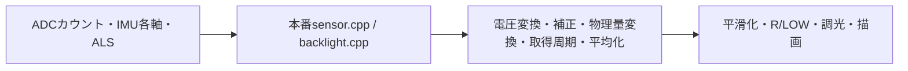

# SDLシミュレーターと等速での動作確認

[確認ページをブラウザーで開く](https://puriso.github.io/racing_gauge/)

通常27ケースと筑波専用2ケースを、独立したジョブ・ページで確認します。
本番の取得・変換・平均化・監視・R/LOWを**60Hz**で実行し、描画とMP4は**24FPS・等速**です。
通常ページは`index.html`、筑波専用は`tsukuba.html`です。各PRの公開コメントに両方のリンクを載せます。
PRのコメントから、ZIPを展開せずGitHub Pages上の確認ページを直接開けます。
1枚の描画までに2〜3回の取得を行い、描画の間だけのピークも履歴・警告判定へ反映します。すべて1.0倍速で、Rモードの3分保持も実時間どおりです。

動画・GIFには、320×240の製品画面の**外側**に入力と期待値を表示します。MP4を直接開いても数値を追えます。

| 外側の表示 | 意味 |
| --- | --- |
| RAW SENSOR / VOLTAGE | ADCの生カウントと電圧、IMUのX/Y/Z（g）、照度の取得値 |
| EXPECTED AVG / FILTER | ADC変換・取得周期・移動平均を経た期待値と、さらに表示用平滑化を通した期待値 |
| Sensor O/W/P・MAX act/exp | 油温・水温・油圧の正常／未取得／通信異常／信号異常と、保持した最高値・独立計算値 |
| EXPECT / ACTUAL | R・LOW・昼/夕方/夜・輝度0〜255・取得照度・6点中央値・油圧過電圧の期待値と実際の状態 |

期待する平滑化値は小数2桁で表示します。実画面には整数化・小数1桁化に加え、
油温0.1℃／水温0.05℃／油圧0.05bar未満の変化を描き直さない処理があるため、数字が完全一致しない場面があります。
輝度は実際の設定値を比較します。SDLの画素を暗くする加工は行いません。

## 生の取得値から計算する経路

温度・油圧や計算済みの水平Gを、センサー配列や判定変数へ直接注入しません。
`sensor.cpp`をそのままリンクし、`acquireSensorData()`を毎フレーム実行します。



- ADCは外部I²C装置のレジスター応答を置き換え、本番`adc_reader.cpp`の初期化・ダミー変換・本取得・5ms期限・1秒再接続を実行します。12bitカウント→電圧→電圧降下補正→温度・油圧の変換を省略しません。
- 配線はCH0=油温、CH1=水温、CH2=油圧。油圧は5点移動平均、温度は500msごとに取得して2点平均します。
- IMUは`getAccelData()`が返すX/Y/Z（g）を置き換えます。200msの安定待ち・20サンプルのオフセット補正・水平G・方向判定・縦軸除外を本番処理で行います。
- ALSは`getAlsValue()`の戻り値を置き換え、8秒周期の測定・6点中央値・輝度判定を本番処理で行います。

`adc-steps`以外のシナリオの℃・bar・Gは生の入力波形を作るための目標です。温度・油圧の逆変換はADC刺激の生成にだけ使い、
表示・判定は必ずADCカウントから再計算します。量子化のため目標値と計算結果には差があります。
たとえば油圧3bar相当のADC=551は約3.000996barとなり、3bar境界も生値から判定します。

起動中にIMU補正が終わるまでは、本番コードが温度・油圧の取得も返さず終了します。
60Hz取得で仮想時刻0から起動した場合は約0.53秒まで初期補正中となり、その後も500msの温度取得・移動平均・平滑化による遅れがあります。
初期バッファを目標値で埋める処理は行いません。

## PR #380の再現確認

確認ページでは、時間の流れで評価する項目と、正確な値で評価する項目を分けています。

| 確認方法 | 項目 | 理由 |
| --- | --- | --- |
| 等速動画を最初から再生 | 再発時のちらつき、保持の継続、旧保持期限をまたぐ次の判定、短い再発後の履歴 | 単一フレームだけでは、一瞬の消灯や途中の状態リセットを見逃すため |
| 動画内のスポットで停止 | 再発開始、旧表示消灯、次の点灯、履歴が更新された時点 | 観察するフレームと数値を特定して比較するため |
| 数値テスト | 499/500ms、2999/3000ms、開始0ms、G=1.0、油圧3.0/3.1bar、32ビット折り返し | 24FPSの動画は約41.7ms刻みで、1msの境界を表現できないため |

- `warning-repeat`（12秒）: 2〜3.5秒の低油圧→復帰・保持→4〜5.5秒で再発。再発を判定中もLOWを保持し、別イベントの履歴を残します。
- `warning-pending`（12秒）: 最初のLOWの保持期限に近い6〜7.5秒で再発。旧表示が消えても次イベントの開始時刻を保持し、新しいLOWを点灯します。
- `warning-brief`（12秒）: 4〜4.25秒だけ再発。直前のLOW保持と有効な履歴が短い低下で壊れないことを確認します。

動画は本番センサーの生ADC・IMU入力から取得・平均化・平滑化を通すため、実際のLOW成立時刻は入力切り替えより遅れます。
確認ボタンの時刻は検証済みのフレームから求め、クリック時は動画を停止して対象フレーム内へ移動します。
「再現の流れを最初から再生」は12秒を等速で連続再生します。

動画の画面外とHTMLには直近のイベントG・最低油圧・継続時間・方向を、実際と独立モデルの期待値で表示します。
数値テストの新旧比較は同じC++テストを旧実装と修正後へ実行した実測結果です。
旧実装の`unsigned long`はESP32と同じ32ビットへ揃え、64ビットホストの型幅による誤判定を避けています。
旧実装の参照コミットとソースのハッシュは`spot-checks.json`に保存します。
ADC入力を各カウント500ms保持する専用試験は追加していません。

## シナリオ

筑波想定の2ケースは、Gに連動して油圧が少し下がる一周モデルを使います。それ以外の通常走行の油圧は、4秒周期で**3.0〜6.0barを連続往復するADC入力**を作ります。
始動直後、意図的な急落、専用の全レンジ試験を除き、5.0barで固定する場面はありません。

| シナリオ | 長さ | 確認する内容 |
| --- | --- | --- |
| `high-g-review` | 140秒 | 危険点なしでも高Gと同G帯の最低油圧を表示。描画の間の約16msのGピークも60Hzで保存 |
| `tsukuba-lap` | 180秒 | 連続走行の中の80秒の注目周。アクセルオフで約2bar低下、徐々に120→140℃、ダンロップ先の短い閾値割れを予兆として記録 |
| `tsukuba-low` | 180秒 | 同じ一周で油圧低下を長くした比較ケース。500msのLOW成立、前後1分の完成グラフと詳細を確認 |
| `risk-window` | 160秒 | LOWの最悪点を中央に前後60秒・油温・何分前かを表示。収集中、DETAIL、メーター復帰後の記録保持を確認 |
| `risk-predictive` | 160秒 | DROP→NEARへの優先更新、一過性低下・通信断・変換タイムアウトの除外、欠損、前後1分を確認 |
| `negative-maxima` | 24秒 | 起動時温度異常でMAX未取得、負温度の初回取得と最高値更新、再冷却・異常後の保持、詳細画面、0℃越えの更新 |
| `menu-monitoring` | 28秒 | 高G中に詳細画面を開き、LOW・温度／油圧ピークを記録。高Gのまま戻ってR再表示・W消去。200msの通信切断でも最高値を保持 |
| `fault-monitoring` | 20秒 | 高G中の短い通信異常でLOWを誤検知しないこと、正常0barでのLOW、200℃超・0V信号異常のERRと復帰 |
| `adc-startup` | 16秒 | 起動時未接続→1秒間隔の再試行→5秒に装置復帰→正常取得 |
| `adc-communication` | 56秒 | 動作中の装置切断・変換未完了・設定書込/状態読取/結果読取/本取得失敗と各復帰 |
| `sensor-disconnect` | 40秒 | 油温・水温の断線相当（5V入力）、油圧信号0V、同時発生と復帰 |
| `temperature-high` | 40秒 | 200℃直前→200℃以上、油温・水温それぞれと両方約583℃、復帰 |
| `temperature-low` | 40秒 | PDF00903Sの動作下限-20℃の前後、油温・水温それぞれと両方が下限未満、復帰 |
| `adc-steps` | 173秒 | CH0・CH1・CH2を直接0→2047→0へ毎フレーム1カウントずつ増減。専用の保持処理は設けず、本番の取得周期で変換・表示を確認 |
| `circuit` | 36秒 | 最大2.0Gの瞬間入力と油圧0.8barへの急落。短時間の非点灯、継続時のR・LOW、回復・保持・消灯 |
| `racing` | 196秒 | 50msの2.0GではRに入らず、1.0G継続で進入。G解除後も3分保持し、時限解除・再進入・詳細画面での解除を確認 |
| `ambient` | 136秒 | 100→12→2→100lux、昼→夕方→夜→昼。8秒ごとの測定・6点の上側中央値・夜間の詳細画面での最大輝度と復帰 |
| `raw-faults` | 24秒 | 油温ADC=0、水温ADC=2047、油圧ADC=1633（過電圧）、全ADC=0、復帰。温度異常・平均化・油圧の異常判定を確認 |
| `ramp` | 200秒 | 油温-10→170→-10℃、水温-10→130→-10℃。上昇後、同じ動画内で保持から下降へ進む |
| `cooldown` | 100秒 | 高温から低温へ下降。バーの消去、赤表示の解除、低温端を確認 |
| `pressure-sweep` | 20秒 | 油圧0→10→0barの専用全レンジ試験。上昇・下降、8bar以上の赤表示を確認 |
| `warnings` | 40秒 | 通常変動中に3.1/3.0/2.9barへ250ms低下。2.9barの2秒保持でLOW点灯・保持・解除 |
| `startup` | 30秒 | 最初の2秒は70℃相当ADCを保持し、IMU補正後の取得を確認。その後-10℃相当へ戻って暖機 |
| `warm-start` | 30秒 | 70℃から暖機。始動後は油圧3〜6barで連続変動 |
| `menu` | 20秒 | 8〜13秒は詳細画面。油圧の変動、通常表示への復帰や残像を確認 |

断線・異常温度の3シナリオは、正常入力から各異常へ切り替え、その後の復帰まで確認します。
製品画面の外側とHTMLに、ケース名、入力電圧の温度換算値（取得・平均前）、入力の異常域、描画に使った温度を表示します。
期待する取得・平均化・平滑化は、引き続き生ADCから独立計算して本番の描画値と照合します。

- `sensor-disconnect`: 4〜8秒は油温断線、12〜16秒は水温断線、20〜24秒は油圧0V、28〜32秒は同時発生。
  NTCがGND側にある回路の断線を、ADC=1666（約5V）で模擬します。油圧の断線電圧は配線次第なので、ここでは入力が0Vへ落ちた条件を模擬します。
  この信号断線シナリオはADC通信異常とは別です。通信異常は`adc-startup`と`adc-communication`で確認します。
- `temperature-high`: 4〜8秒は油温ADC25（約197.57℃）、8〜12秒は24（約200.30℃）。
  16〜24秒は同じ順で水温、28〜32秒は両方ADC1（約583.29℃）。
- `temperature-low`: 4〜8秒は油温ADC1429（約-19.93℃）、8〜12秒は1430（約-20.04℃）。
  16〜24秒は同じ順で水温、28〜32秒は両方ADC1430。
- 指定時間以外は正常入力へ戻し、通常油圧は3〜6barで動かします。
- 温度センサーはユーザー確認済みの**Defi PDF00903S**です。[メーカー資料](https://defi.nippon-seiki.co.jp/wp-content/uploads/2025/03/manual_din.pdf)の**動作範囲-20〜150℃**を確認ページの比較基準にします。
  下限・上限そのものは範囲内、下限未満・上限超過を仕様範囲外とします。保存温度範囲やメーターの表示範囲とは区別します。
  仕様範囲外という分類は、故障の断定や製品側の異常判定ではありません。200℃以上の高温ケースは引き続き極端な異常入力として残します。
  ADC1429/1430の換算温度はリポジトリのNTCモデルによる参考値で、メーカーの校正保証値ではありません。
  **現在のmainは199℃以上を表示側で除外しますが、センサーの動作下限による除外処理はありません。**
  低温シナリオでは、負値を表示する現在の挙動を確認できます。シミュレーター側で値を補正したり、0表示へ置き換えたりしません。

`adc-steps`は最初の2秒でIMU補正を待ち、以後はCH0・CH1・CH2を毎フレーム1カウントずつ
`0→2047→0` と連続的に往復させます。折り返し後も同じ順序で動き続け、各値を保持する専用処理はありません。
CH3は未使用の0です。刺激は24Hzで1カウントずつ変え、取得は60Hz、描画は24FPSです。描画に出ない中間の取得値も`raw_samples`とCSVで全件確認します。
温度からの逆変換を使わず、℃・barの変換・平均化・平滑化は生ADCから本番処理で計算します。
温度の取得は本番どおり500ms周期のため、全カウントが温度サンプルとして取得されるわけではありません。
動画の一時停止・確認時刻ボタンと入力JSONで、上昇・下降の中間カウントを確認できます。

`circuit`の主な時刻:

| 時刻 | 入力・確認する動作 |
| --- | --- |
| 4.00〜4.05秒 | 2.0Gと0.8bar相当ADCへ同時に急変。60Hzで取得し、R・LOWとも非点灯 |
| 8.00〜10.50秒 | 2.0Gと0.8barを継続。R進入、LOW点灯、油圧回復後の表示保持 |
| 18.00〜18.20秒 | 2.0Gと0.8barへ200msだけ低下。LOWは点灯しない |
| 22.00〜24.00秒 | 再度継続して急落。LOWの再点灯と回復を確認 |

Gは各軸の取得値から算出します。4秒＝前、8秒＝右、18秒＝左前、22秒＝左の入力です。
14〜15秒は縦軸だけを1→3gへ変化させ、水平Gは0のままであることも確認します。

`racing`の確認時刻は2.1秒（短いGで非進入）、4.2秒（進入）、184秒（保持中）、
184.3秒（3分後の解除）、187.3秒（再進入）、190秒（詳細画面での解除）です。
入力とゲージ表示には本番の平均化・平滑化による遅れがあります。
描画は約41.7ms刻み、取得と判定は約16.7ms刻みです。判定結果を次の24FPSフレームへ反映します。
Rは1.0G以上が100ms継続、LOWは1.0G超かつ表示用油圧3bar以下が500ms継続すると点灯します。
`racing`は2luxの夜間入力です。R中の最大輝度と3分後の夜間輝度への復帰も確認します。

照度の判定は中央値15lux以上が昼（255）、10lux以上が夕方（200）、未満が夜（60）です。
現在の製品コードでは中央値バッファの未取得分を0として扱うため、100luxでも起動後16秒までは夜になります。
`ambient`では16秒＝昼、48秒＝夕方、88秒＝夜、96秒＝詳細画面で最大輝度、98秒＝夜へ復帰、120秒＝昼を確認できます。
自動測定はR・詳細画面中に停止し、入力照度と最後に取得した値を区別して表示します。

## ローカルで起動する

Python 3.11以降、C++17コンパイラー、SDL2とpkg-configが必要です。
macOSではXcode Command Line Toolsも必要です。

```sh
brew install sdl2 pkg-config
```

Ubuntu:

```sh
sudo apt-get update
sudo apt-get install -y build-essential libsdl2-dev pkg-config
```

リポジトリのルートで実行します。

```sh
python3 -m venv .venv
source .venv/bin/activate
python -m pip install -r simulator/requirements.txt
pio run -d simulator -e desktop
simulator/.pio/build/desktop/program --scenario circuit
```

320×240の本番描画を2倍で表示します。
Spaceで一時停止、Homeで再生を戻し、Mまたはクリックでグラフを開閉し、グラフ右上のDETAILから従来の詳細画面へ進みます。
再生を戻しても仮想時計・ピーク値・平滑化履歴は保持します。初期状態で比較する場合は再起動してください。
`--seconds`では5〜240秒の再生時間を指定できます。Rの保持時間自体は本番設定のままです。

## 録画と確認ページを生成する

```sh
python simulator/record.py --output simulator/out/my-review
```

29ケースを実行し、通常27ケースの`index.html`と筑波2ケースの`tsukuba.html`を作ります。
`--suite standard`と`--suite tsukuba`でテスト群を独立して実行できます。CIも別ジョブで並行実行します。
ファイルをブラウザーで直接開けます。動画を参照するため、フォルダー全体を保持してください。
`--scenario circuit`などで個別に実行でき、ビルド済みなら`--skip-build`を付けられます。
既存の出力先は上書きしません。FFmpegはPythonパッケージに同梱されています。

- `index.html`: シナリオ一覧、確認時刻への移動、等速での連続再生、生の入力・期待値・R・LOW・照度・輝度
- `<scenario>/recording.mp4`: H.264、640×540、24FPS、等速。終点の1フレーム（約41.7ms）も含む。画面外に数値を合成
- `<scenario>/poster.png`: 数値付きの動画ポスター
- `<scenario>/frame-*.png`: 24FPSの全転送先フレーム。圧縮にじみのない画素確認用
- `<scenario>/contact-sheet.png`: 代表フレームの一覧
- `<scenario>/inputs.json`: schema_version=3。`fps=24`、`sample_hz=60`。`frames`は描画時点の最新取得値・独立期待値・描画値で、`sample_index/sample_time_ms`が使用した取得を示します。`raw_samples/sample_columns`に60Hzの全入力も収録します。
- `<scenario>/trace.csv`: ADC・IMU・照度・目標波形を記録した60Hzの全入力。CSV自体はActions成果物、同じ入力列は公開JSONにも保存
- `public/`: 公開用のindex.html・MP4・代表画像・JSON。全PNGは含めず、公開データ量を抑える

入力範囲、連続した油圧変動、温度の上昇・下降、Rの非進入・進入・保持・解除を自動検証します。
さらに実際の転送先PNGでR表示との一致、LOWの点灯・保持・消灯、油温バーの枠内描画と赤色の解除を確認します。
取得60Hzの全入力と描画24FPSの全フレームで、生ADCからの変換・ダミー読み取りを含む取得回数・最終取得値・取得周期・平均化・IMU補正と方向・R/LOW・調光を独立モデルと照合します。
さらに、平滑化と描画値の差が部分描画の更新幅以内か確認します。
MP4も再デコードして破損を検出します。それ以外の外観は確認ページで目視してください。

## GIFが必要な場合

CIはGIFを自動生成せず、等速動画の確認ページを公開します。
個別にGIFを作る場合も、全区間を平均24FPS・1.0倍速で保存します。倍速化や途中区間の省略はしません。
GIFは10ms単位の形式なので、40ms/50msを配分して24フレームの合計を1秒にします。累積誤差は10ms未満です。
動画と同じ比較欄を付けます。GIFを作る前に、新しい録画処理で`inputs.json`と原画像を生成してください。

```sh
python simulator/make_demo.py --recordings simulator/out/my-review --scenario circuit --output simulator/out/circuit.gif
```

## GitHub PagesとCI

[SDL Visual Recording](../.github/workflows/visual-simulator.yml)は、描画・設定・シミュレーターに関係するPRとmainへのpushで実行します。
手動実行ではシナリオを選べます。

同じリポジトリ内のPRでは、録画・検証が成功するとGitHub Pagesへ公開し、既存のPRコメントを更新します。
確認URLは`previews/pr-<番号>/<コミットSHA>/`です。コミットごとの録画を保持し、PRごとの入口からは最新の成功した録画を開けます。
公開用ファイルは`visual-previews`ブランチの`docs/`へ保存し、GitHub Pages用の成果物として明示的にデプロイします。
main・PRのコードは公開処理で変更しません。

PagesはGitHub Actions方式で設定し、`github-pages`環境から信頼する同一リポジトリ内PRの公開を許可します。
fork・Dependabotでは公開とコメントを省略します。録画ジョブは読み取り専用です。
公開ジョブは検証済みの成果物だけを使い、許可したパス・通常ファイル・サイズ上限を確認します。
公開ブランチのコードや成果物内のスクリプトは実行しません。公開を直列化し、別PRの録画も保持します。

全PNGを含む`visual-simulator-standard` / `visual-simulator-tsukuba`成果物はActionsに14日間保存します。
公開用の動画とHTMLはGit履歴として残ります。mainへのpushと手動実行では成果物の保存までを行います。

## 実装範囲

[M5GFX SDL](https://github.com/m5stack/M5GFX/blob/master/examples/PlatformIO_SDL/README.md)の本番レンダラーを使用します。
`rendering.cpp`が`src/modules/sensor.cpp`を含む本番モジュールを直接リンクし、取得APIの戻り値と時刻だけを仮想化します。
毎秒24回の本番処理を実行し、各フレームの転送先フレームバッファを保存します。
仮想時刻はフレーム番号から計算し、41ms/42msの端数を累積させず、24フレームで正確に1秒進みます。
仮想実行自体は実時間より速く完了しますが、生成した動画の再生速度は等速です。
24FPSは動作確認用の設定値です。ADC/I²Cの電気特性・通信遅延、IMUのレジスタ→g変換、ALSのドライバー内部処理、電源・タッチの実機動作は検証しません。
ファームウェア側のビルド・書き込み設定は変更しません。

## English

The simulator feeds raw ADC counts, IMU axes and ALS readings through the unmodified production sensor pipeline and M5GFX SDL.
Twenty-nine real-time scenarios in separate standard and Tsukuba suites cover synthetic Tsukuba 2000 laps, continuous 3–6bar pressure, sudden 2.0G/pressure drops, R activation/three-minute hold/expiry,
heating/cooling, startup, menus, lighting and raw ADC faults. Production calibration, acquisition intervals,
sample buffers and IMU offset/direction calculations are executed rather than injecting derived values.
Videos and optional GIFs carry raw readings and independently calculated average/filter expectations outside the original 320×240 screen.
The HTML review page offers normal-speed video, timestamp links and input/state readouts.
Trusted same-repository PRs publish a commit-specific GitHub Pages URL; full PNG artifacts remain in Actions for 14 days.
Optional GIF generation is also real-time. Electrical behavior, bus timing and hardware performance are outside this simulator's scope.
Sensor acquisition and monitoring run at 60 Hz; display and MP4 run at 24 FPS and normal speed. The standard and Tsukuba suites have separate pages and CI jobs.
FPS benchmarking, comparison CLI options and performance reports are removed.

### LOWの発生履歴W

LOWが500msの継続条件を満たすと、左下のRの右に赤いWを表示します。LOWが消えても保持します。画面をタップして詳細画面を開いた時点では履歴を保持し、もう一度タップしてゲージへ戻るとWを消去します。警告条件が継続していれば再点灯し、再起動時には履歴は初期化されます。直近イベントの数値記録はWの消去では消しません。

`warning-history`は20秒・24FPS等速で、LOW成立→LOW消灯後のW保持→8秒に詳細画面を開く→10秒にゲージへ戻りWを消去→14秒からの再発を再現します。生ADC/IMU入力と詳細画面の開閉を記録し、独立モデル・転送先のWの画素まで照合します。

```sh
python test/low_warning/run_tests.py --history
python simulator/record.py --scenario warning-history
```

## ADC通信異常の動画と数値テスト

`adc-communication`は4〜8秒に装置未接続、12〜16秒に変換完了ビットが戻らない状態、20〜24秒に設定書込失敗、28〜32秒に状態読取失敗、36〜40秒に結果読取失敗、44〜48秒にダミー取得後の本取得失敗を注入します。間の区間と最後の48〜56秒は正常です。
`adc-startup`は開始から5秒まで未接続、以降は正常です。IMUの起動時補正後もADCが応答しない場合、温度は200℃の異常値としてバッファを初期化し、表示側では0℃へ向けて平滑化します。油圧の取得バッファは0へ初期化します。復帰後は最初の正常温度から平均化を再開します。

画面外とHTMLには外部応答・ADCの接続状態・初期化試行回数・最後に成功した取得値・変換結果の取得回数を表示します。RAW ADCは模擬装置へ与えた入力であり、通信失敗時に取得できた値ではありません。ダミー取得は成功回数に含みますが、本取得失敗時の値はセンサー平均へ反映しません。

仮想ポーリング待ち時間の5msは、本番処理が`delay(1)`を5回通る期限判定の値です。実機のI²C転送時間やFPSの推定ではなく、取得60Hz・描画24FPSの基準時刻も変えません。SDLの内部時計は変更しません。電気特性・バスの物理的な状態・実機応答時間は検証対象外です。

24FPS動画は約41.7ms刻みです。5msの期限、999/1000msの再試行境界、符号拡張・ダミー取得・復帰時のバッファ初期化は、次の本番C++テストでも検証します。

```sh
python test/adc_reader/run_tests.py --check-legacy
python simulator/record.py --scenario adc-communication
python simulator/record.py --scenario adc-startup
```

## 初回のADC初期化エラー画面

`adc-startup`の先頭フレーム（0秒）はsetup直後・初回loop前を収録します。実機と共通の描画関数で、赤い `ADS1015 init failed` / `Check wiring` を描きます。
確認ページの「初回エラー・loop前」で停止でき、静止画像（poster.png）も直接開けます。続く「初回loop」では通常ゲージへ移り、未接続時の取得値・1秒間隔の再接続・5秒以降の正常復帰を確認します。

録画は24FPS・等速のままです。エラー画面はsetup直後の1フレームとして記録し、確認用の長時間保持は設けません。未描画のゲージ値はJSONでnull、確認ページで「未描画（初回loop前）」と表示します。初回loop前に取得・平均化・平滑化を実行した数値としては扱いません。

## 部分転送と監視の回帰確認

LCD転送は上段・左ゲージ・右ゲージ・左下の表示を別々にクリップし、離れた更新を全面へ結合しません。
各録画フレームで転送先と元キャンバスの全画素を照合し、転送漏れを検出します（setupから直接描く初回エラー画面は専用検証）。
数値文字列が変わらない場合は再描画を省き、固定目盛りを保持します。DMA完了を転送先で待ってから次の描画へ進みます。
実機FPSの推定・計測シミュレーションは追加せず、録画は24FPS・等速です。

監視・最高値・LOWは詳細画面中も毎フレーム更新します。最高水温は正常な取得平均値の最大で、表示平滑化の遅れに依存しません。
ADC通信異常は温度の次回500ms取得を待たず全チャンネルへ反映し、無効値ではLOWを新規成立させません。
最高値と成立済み履歴は異常後も残し、Wは従来どおり詳細画面から戻る際に消去します。

## 負温度の最高値

最高値は初回正常値から記録し、0を初期値として負温度を切り捨てません。
未取得・起動時異常の間は上段MAXと詳細画面を`---`で表示し、JSONでは最高値をnullにします。
正常値を取得した後は、再冷却・信号異常・通信異常・詳細画面の開閉で最高値を失いません。

`negative-maxima`は24秒の等速動画です。最初の2秒は温度異常、その後は油温-15℃／水温-18℃相当のADC、
6〜9秒は-8℃／-12℃、9秒から再冷却します。12〜15秒に温度異常を挟み、19秒から5℃／10℃へ移します。
8〜10秒、13〜14.5秒、22秒以降は詳細画面で最高値を確認します。
期待値は目標温度を直接採用せず、生ADCの換算・取得平均から独立計算します。整数化・ADC量子化による差も含みます。

本番の最高値記録クラスは`python test/recorded_maximum/run_tests.py`で、初回負温度、負温度同士の更新、
未取得、異常前後、NaN/無限値、正常0℃、正温度への更新、チャンネル間の独立性を検証します。

## 危険場面グラフと予兆

### 筑波2000想定の合成一周

区間順序は筑波サーキットの[公式コース図](https://www.tsukuba-circuit.jp/guide/img/course-spec_2000_01.pdf)を参考にしています。
**80秒というラップ時間、各区間の時刻・G・油温・油圧は、ユーザー指定の条件を確認するための合成値です。実測テレメトリーではありません。**
最大負荷をダンロップ後の80R/170Rに置くことも、この試験の条件です。

| 動画の時刻 | 区間・動作 |
| --- | --- |
| 0〜0.8秒 | IMU補正のため静止 |
| 0.8〜60秒 | 前周を走行し、加減速・旋回に合わせてGとアクセルを動かす |
| 60〜64秒 | ホームストレート、一周の開始 |
| 64〜71秒 | 第1コーナー |
| 71〜78秒 | S字 |
| 78〜88秒 | 第1ヘアピン |
| 88〜97秒 | ダンロップ |
| 97〜107秒 | 80R/170R。左Gが最大2.0、100秒付近だけ油圧が3barを割る |
| 107〜117秒 | 第2ヘアピン |
| 117〜128秒 | バックストレート |
| 128〜140秒 | 最終〜ホーム。注目する一周を終え、その後も次周を走行 |
| 145秒 | 走行後のグラフを開く |
| 168秒 | 最悪点の前後60秒が揃ったグラフと発生からの経過時間を確認 |
| 170〜172秒 | DETAILで従来画面、174秒にグラフへ戻って記録保持を確認 |

油温は全180秒を通して120→140℃へ上がり、アクセル量の積分で上昇速度を変えます。全開区間の上昇速度はアクセルオフ区間の約3倍です。
油圧はアクセル主体で、全開→オフの100ms遷移で直前より約2bar低下し、G・油温の小さな影響も重ねます。80Rの注目周だけ追加の短い低下を与えます。
IMU補正後は前後の周回も連続して動かし、直線中も加減速・横Gの小さな変化を残します。アクセル情報は合成波形の生成と検証用で、本番判定へ直接注入しません。
`tsukuba-lap`は3bar以下の短い低下を、LOW未成立の予兆として記録します。
`tsukuba-low`は同じ箇所の低下だけを長くし、500ms以上でLOWが成立する比較ケースです。警告条件は変更しません。
どちらもADCカウントとIMU各軸を本番処理へ入力し、温度・油圧・G・方向・LOW・危険点を独立モデルと全フレーム照合します。
区間名・一周の経過・合成データであることは動画の画面外と確認ページへ表示します。動画は24FPS・等速です。

### 危険点がない場合の代表点

正常圧力を1秒連続取得した後は、危険点がなくても`PEAK G`を表示します。最大0.1G帯を優先し、同じ帯なら低い0.05bar帯、同順位なら先の時刻を保持します。
危険点が成立したら代表点より優先し、その後の正常な高Gだけでは上書きしません。正常値未取得の間だけ`WAITING`です。
`high-g-review`の3秒で通常時のグラフ、31秒で描画の間に入った30.05秒のGピーク、44/77秒で同G帯の低い油圧への更新、138秒で完成グラフを確認します。

### 危険点選択の専用ケース

`risk-window`は40秒にF・1.4G、55秒にR・1.8G、75〜78秒にL・2Gと0.8bar、95秒にB・1.2Gを生IMU各軸で入力します。76秒から収集中のグラフ、82秒にDETAIL、
84秒のメーター復帰でWだけ消去し、145秒には前後60秒が揃った同じ危険点を表示します。
145秒の完成グラフで、油圧は黄・Gは水色の線/目盛り/選択値/ピーク方向表示に揃い、Gの各ピークにF/R/L/Bが残ることを確認できます。
油温グラフの中央に対応するラベルと上部の0秒の数値に、記録した瞬間の油温を小数1桁で表示します。動画外とHTMLにも同じ記録時油温を表示します。
油温軸は記録値の最小・最大へ10%（最低1℃）の余白を付け、1℃単位で追従します。一定温度でも最低6℃の軸幅を確保し、異常値と未収集部分は軸の計算から除外します。
`risk-predictive`は65秒にDROP、75秒にNEAR、90秒に100msだけ低下、95秒に通信断、105秒に変換未完了を注入します。
LOW未成立の予兆は橙色で表示し、Wは点灯しません。予兆の条件はREADMEの表に記載しています。

本番`risk_history.cpp`は、生ADCから本番取得・平均化・平滑化を通した監視値を使用します。
Pythonの独立モデルが各フレームの種類、選択時刻、油圧・G・油温、経過時間、PRE/POSTを照合し、
最終的な1201区間の保持データも全件比較します。`risk_window`の各行は油圧最小/最大（0.01bar）、G最大（0.01G）、
油温最新（0.1℃）、有効/異常フラグ、最大G時の主方向（0=なし、1=F、2=R、3=L、4=B）です。
方向は最大Gと同時に更新し、後続の小さいGでは書き換えません。同値なら先の方向を残します。主方向は補正後IMUの前後・左右で強い成分から独立計算し、各フレームと保持した1201区間を照合します。
データのない前後はフラグ0、通信異常は欠損フラグで区別します。

メーター→グラフ→DETAIL→メーター、およびグラフ→メーターの遷移を本番の共通コントローラーで実行します。
既存ケースの詳細画面確認はDETAILを指定して継続し、危険点・通常時の代表点・筑波のケースで初回タップからのグラフを検証します。
グラフは最大2Hzで更新し、収集完了後は経過時間の見出しだけ更新します。動画は従来どおり24FPS・等速です。

本番の固定長履歴・危険点選択・時計折り返し・画面遷移は`python test/risk_history/run_tests.py`で検証します。
実機のタップ座標は描画用ディスプレイと同じ回転で変換します。履歴は起動中のみ保持し、電源OFFで消えます。

フラグは1=油圧有効、2=G有効、4=油温有効、8=成立LOW、16=油圧異常、32=油温異常です。
同じ100ms区間に正常・異常が混在した場合は異常を優先し、その系列を空白にします。
